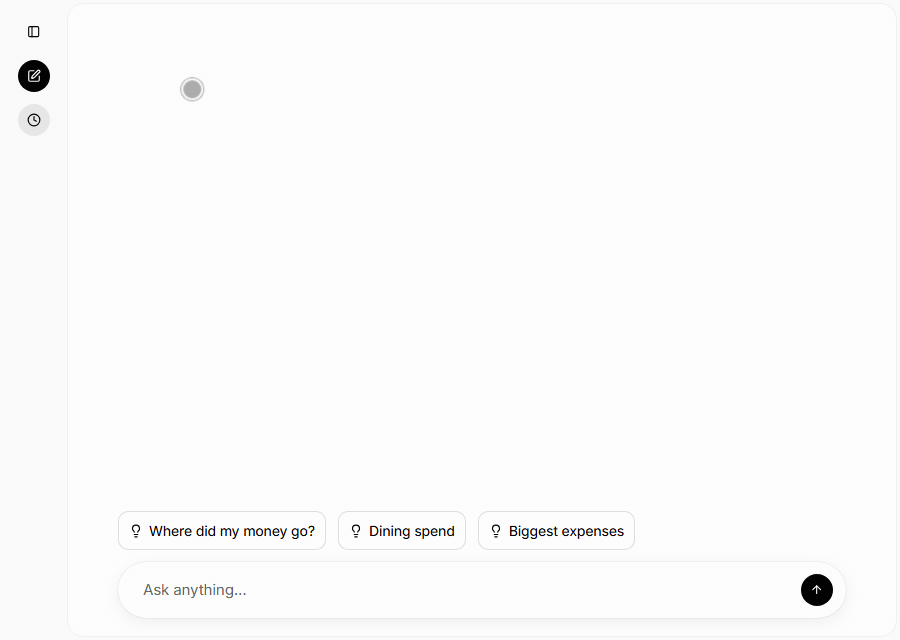
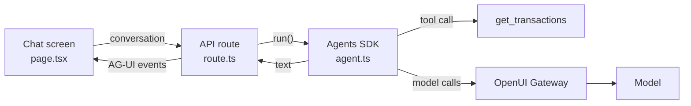
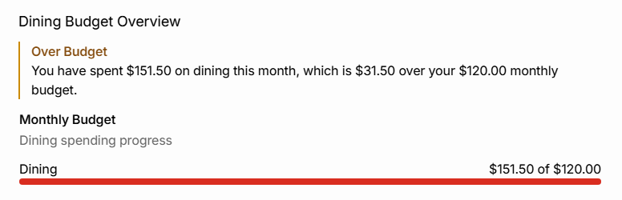

# Budget Buddy: a generative UI chat agent with OpenUI and the OpenAI Agents SDK

Budget Buddy is a chat agent that answers questions about a month of spending with charts and tables instead of paragraphs. This repo is a small, commented example of how to connect the [OpenAI Agents SDK](https://openai.github.io/openai-agents-js/) to [OpenUI](https://www.openui.com/docs/build-agents/how-it-works).

Video Demo - https://youtu.be/37ue1b0HlzY

## QuickStart

About 5 minutes, if you already have Node.js 22 or newer. You also need a free Thesys API key from <https://console.thesys.dev/keys>.

```bash
git clone https://github.com/anmolbajpai24/openui-sample.git
cd openui-sample
npm install
cp .env.example .env.local
npm run dev
```

Put your key in `.env.local` before the last command. Then open <http://localhost:3000> and click "Where did my money go?". [Setup](#setup) has the same steps in more detail.

## What you'll build



You ask where your money went. The agent looks up the transactions with a tool and replies with a summary, a chart, a table and a row of buttons.

## Starting point and what's new

The structure of this repo is based on the official [google-adk example](https://github.com/thesysdev/openui/tree/main/examples/agent-frameworks/google-adk) in [thesysdev/openui](https://github.com/thesysdev/openui). These parts are new:

- The Agents SDK bridge. [`src/app/api/chat/route.ts`](src/app/api/chat/route.ts) turns the Agents SDK's text stream into AG-UI events.
- `parseMessage` on the full history. Every user and assistant message in the conversation goes through `parseMessage`, so OpenUI's marker lines never reach the model.
- The Budget Buddy tools. `get_transactions` in [`src/agent.ts`](src/agent.ts) adds up the totals in code. [Add a tool](#add-a-tool) adds a second one, `get_budgets`.
- The terminal and curl harness. `npm run agent` and [`scripts/sample-request.json`](scripts/sample-request.json) test the agent and the route without the browser.

## Prerequisites

- [Node.js](https://nodejs.org/) 22 or newer, which the Agents SDK [requires](https://openai.github.io/openai-agents-js/guides/troubleshooting/). Check with `node --version`.
- Git.
- A Thesys account for the API key. The free plan is enough.
- Basic React and TypeScript.

## Setup

1. Clone the repo and go into the folder.

   ```bash
   git clone https://github.com/anmolbajpai24/openui-sample.git
   cd openui-sample
   ```

2. Install the dependencies.

   ```bash
   npm install
   ```

3. Add your API key. Create one at <https://console.thesys.dev/keys>, then copy the example file.

   macOS or Linux:

   ```bash
   cp .env.example .env.local
   ```

   Windows PowerShell:

   ```powershell
   Copy-Item .env.example .env.local
   ```

   Open `.env.local` and replace `your-key-here` with your key. Git ignores this file.

4. Start the app.

   ```bash
   npm run dev
   ```

   This first regenerates `src/generated/spec.json`, a description of the components the agent can use. When you see `✓ Ready`, open <http://localhost:3000>.

You should see a message box and three starter buttons. Click the "Where did my money go?" starter. The chat shows "Working" for a few seconds, then draws the reply piece by piece.

The model is free and has a daily request limit, listed on the [Gateway pricing page](https://www.openui.com/docs/gateway/pricing-credits). Each question uses two model calls. If something goes wrong, see [Common errors](#common-errors).

## How it works

The agent writes UI instead of text. Most chat agents reply in Markdown. Budget Buddy replies in OpenUI Lang, a compact language that describes an interface as a set of components, and the browser draws that text with OpenUI's built-in React components. For example, a reply can contain lines like these:

```text
root = Stack([header, summaryBlock, tabs, actions])
pie = PieChart(catLabels, catValues, "donut")
catValues = [1200, 243.25, 151.5, 129, 124.29, 68.6, 25.98]
btnDining = Button("Show me dining", @ToAssistant("Show me dining transactions"), "secondary")
```

Each line names a component and gives its arguments. Drawing starts at `root`.

The diagram below uses two terms. OpenUI Gateway is an OpenAI-compatible endpoint from Thesys that sits between your code and the model. AG-UI is an open protocol that sends an agent's activity to a UI as small JSON events.



The path of one question:

1. You click a starter. `page.tsx` posts the whole conversation to `/api/chat`.
2. `route.ts` converts the messages and starts the agent with `run()`.
3. Model call one: the Agents SDK calls the model through Gateway, and the model asks for the `get_transactions` tool.
4. The SDK runs the tool, which is ordinary TypeScript in `agent.ts`. The server terminal prints `[tool] get_transactions(all)`.
5. Model call two: the SDK sends the result back, and the model writes its reply in OpenUI Lang.
6. `route.ts` wraps each piece of that text in an AG-UI event and streams it to the browser.
7. The chat screen draws each component as its line arrives.

### What happens when you click a button

The last line of the excerpt is a button. `@ToAssistant("...")` tells the chat screen to send that text as a new user message, so a click is one more post to `/api/chat`. For a click on "Show me dining", the newest message in that post is:

```json
{
  "role": "user",
  "content": "]]>openui:content\nShow me dining transactions\n]]>openui:context\n[\"User clicked: Show me dining transactions\",{}]",
  "id": "f0e25cb6-4d21-4e24-abeb-6d769161e0b3"
}
```

The `]]>openui:` lines are markers from OpenUI's [message format](https://www.openui.com/docs/openui-lang/message-protocol). They separate the text from extra context, such as the values of a form. `route.ts` keeps the text and the context and drops the marker lines before the model sees the message. The server terminal then prints:

```text
[tool] get_transactions(dining)
```

Nothing is saved on the server. The browser keeps the conversation in memory and sends all of it each time, so a refresh clears the chat.

## Walkthrough

### 1. `src/agent.ts`: the agent and its tool

This file defines Budget Buddy, and both the terminal script and the API route import it. Two parts of it connect the Agents SDK to OpenUI. The first sends every model request to Gateway instead of straight to OpenAI:

```ts
setDefaultOpenAIClient(
  new OpenAI({
    baseURL: "https://api.thesys.dev/v1/embed",
    apiKey: process.env.THESYS_API_KEY,
  }),
);
```

The second builds the agent's instructions:

```ts
const instructions = generateSystemPrompt({
  cloud: true, // Gateway writes the manual. Without this it is written here, locally.
  library,
  promptOptions,
  instructions: budgetBuddyRules,
});
```

`library` is the component list from `spec.json`. With `cloud: true`, the function packs that list into a block for Gateway and adds the agent's rules after it. Gateway writes the OpenUI Lang manual for the model and checks the reply against the same list as it streams. In one run the model used a name it never defined (`topLhs`), and Gateway sent a corrected copy in the same stream.

The tool filters the mock transactions and adds up the totals in code, so the model does not have to.

Try this layer alone:

```bash
npm run agent -- "How much did I spend on dining?"
```

````text
]]>openui:content?thesys=true
Let me fetch your dining transactions for this month.
[tool] get_transactions(dining)

]]>openui:content?thesys=true
```openui-lang
root = Stack([header, summaryCard, tableHeader, txTable, nextStepsHeader, nextSteps])
header = CardHeader("Dining Expenses", "October 2026 breakdown and transactions")
summaryCard = ContextCardBlock([totalItem], "grid", true)
totalItem = ContextCardItem("dining-total", "Total Dining Spend", "**$151.50**")
tableHeader = InlineHeader("Recent Dining Transactions", "4 transactions this month")
... 18 more lines ...
````

The 18 lines left out are the rest of the program, then `]]>openui:end` and `[done]`. Both model calls are visible: one sentence and a tool request, then the program inside the `openui-lang` fence. Each `]]>openui:content` line comes from Gateway and starts a new section. The chat screen draws only the last one, so the browser never shows the "Let me fetch" sentence.

### 2. `src/library.ts` and the spec

```ts
export {
  openuiLibrary as library,
  openuiPromptOptions as promptOptions,
} from "@openuidev/react-ui/genui-lib";
```

That is the whole file. It re-exports OpenUI's built-in library of 82 components.

The browser needs the React components, but the server only needs a description of them. That description is the spec. `npm run spec` creates it by running the OpenUI CLI on `library.ts`. One entry from `src/generated/spec.json`:

```json
    "CardHeader": {
      "signature": "CardHeader(title?: string, subtitle?: string)",
      "description": "Header with optional title and subtitle"
    },
```

`npm run dev`, `npm run build` and `npm run agent` each run `npm run spec` first. `page.tsx` imports the same `library.ts`, so every component the agent can write is one the browser can draw.

### 3. `src/app/api/chat/route.ts`: the bridge

The Agents SDK produces a stream of plain text, and OpenUI's chat screen reads AG-UI events. This file turns one into the other. OpenUI ships adapters for several stream formats but none for the Agents SDK. For that case its docs [give a pattern](https://www.openui.com/docs/agent/reference/self-hosting): translate to AG-UI on the server and read the events with `agUIAdapter()` in the browser. This route does that in about 100 lines. The steps below are the numbered comments in [`src/app/api/chat/route.ts`](src/app/api/chat/route.ts).

The chat screen stores every message with marker lines that start with `]]>openui:`. OpenUI's [message format page](https://www.openui.com/docs/openui-lang/message-protocol) says the model must never see those lines. Step 1 takes them out with `parseMessage` while it converts each of the browser's messages with the SDK's `user()` and `assistant()` helpers:

```ts
      const { content, context } = parseMessage(message.content);
      if (message.role === "assistant") return assistant(content);
      return user(context ? `${content}\n\nContext: ${JSON.stringify(context)}` : content);
```

A reply goes back to the model as its content only. A user message also carries its context as plain text, such as the values of a submitted form.

Step 3 runs the agent in streaming mode with `run(budgetBuddy, conversation, ...)`. Step 4 wraps each piece of text in an event. `send` writes each event to the browser as one `data:` line:

```ts
        send({ type: "TEXT_MESSAGE_START", messageId, role: "assistant" });
        for await (const delta of result.toTextStream()) {
          send({ type: "TEXT_MESSAGE_CONTENT", messageId, delta });
        }
        send({ type: "TEXT_MESSAGE_END", messageId });
```

A few things to notice in the file:

- A request body that is not JSON, or has no `messages` array, gets a 400 response with a JSON error before any of this runs.
- `run()` handles the whole tool loop. Both model calls and the tool call happen inside it.
- `toTextStream()` yields only the model's text, which is why the browser shows "Working" while the tool runs.
- `signal: request.signal` stops the run when the user presses stop or closes the tab.
- If the run throws, the `catch` block sends a `RUN_ERROR` event and the chat shows its message.
- The `finally` block closes the stream. The chat screen keeps its loading state until then.

<details>
<summary>Try this layer alone with curl</summary>

With `npm run dev` running, open a second terminal in the project folder.

macOS or Linux:

```bash
curl -N http://localhost:3000/api/chat -H "Content-Type: application/json" -d "@scripts/sample-request.json"
```

Windows PowerShell, where plain `curl` is a different command:

```powershell
curl.exe -N http://localhost:3000/api/chat -H "Content-Type: application/json" -d "@scripts/sample-request.json"
```

One run produced 46 events. The first four:

```text
data: {"type":"RUN_STARTED","threadId":"curl-test","runId":"bb7c0b56-236e-4027-89cc-bd2bdce4890b"}

data: {"type":"TEXT_MESSAGE_START","messageId":"cc9c5dcf-ce80-4a1f-aace-e724cb533b94","role":"assistant"}

data: {"type":"TEXT_MESSAGE_CONTENT","messageId":"cc9c5dcf-ce80-4a1f-aace-e724cb533b94","delta":"]]>openui:content?thesys=true\nI will retrieve your transactions for this month to analyze your spending."}

data: {"type":"TEXT_MESSAGE_CONTENT","messageId":"cc9c5dcf-ce80-4a1f-aace-e724cb533b94","delta":"]]>openui:content?thesys=true\n```openui-lang\nroot = Stack([header, summaryBlock, chart"}
```

The stream ends with `TEXT_MESSAGE_END` and `RUN_FINISHED`. It is the same kind of text `npm run agent` prints, cut into pieces and wrapped.

</details>

### 4. `src/app/page.tsx`: the chat screen

```tsx
const llm = fetchLLM({
  url: "/api/chat",
  streamAdapter: agUIAdapter(),
});
```

`fetchLLM` posts the conversation to the route, and `agUIAdapter()` reads the events that come back. `AgentInterface`, OpenUI's ready-made chat screen, takes that `llm` object and the same `library` the spec came from:

```tsx
    <AgentInterface
      llm={llm}
      componentLibrary={library}
```

The only other frontend code is the line in `src/app/globals.css` that imports OpenUI's styles.

## How to extend it

### Add a tool

In `src/agent.ts`, define a second tool below `getTransactions`:

```ts
const getBudgets = tool({
  name: "get_budgets",
  description: "Get the monthly budget limit for each category that has one.",
  parameters: z.object({}),
  execute: async () => {
    console.log("\n[tool] get_budgets()\n");

    return {
      currency: "USD",
      budgets: [
        { category: "groceries", limit: 300 },
        { category: "dining", limit: 120 },
        { category: "shopping", limit: 150 },
      ],
    };
  },
});
```

Then add it to the agent at the bottom of the file: `tools: [getTransactions, getBudgets]`. Nothing in `route.ts` or `page.tsx` changes. The SDK's [tools guide](https://openai.github.io/openai-agents-js/guides/tools/) has the other options.

### Add your own component

Create `src/budget-meter.tsx`. A component is a name, a description for the model, a Zod schema and a React function.

<details>
<summary>src/budget-meter.tsx</summary>

```tsx
import { defineComponent } from "@openuidev/react-lang";
import { z } from "zod";

export const BudgetMeter = defineComponent({
  name: "BudgetMeter",
  description: "A bar showing how much of a budget has been spent.",
  props: z.object({
    label: z.string(),
    spent: z.number(),
    limit: z.number(),
  }),
  component: ({ props }) => {
    const percent = Math.min(100, Math.round((props.spent / props.limit) * 100));
    const over = props.spent > props.limit;

    return (
      <div>
        <div style={{ display: "flex", justifyContent: "space-between" }}>
          <strong>{props.label}</strong>
          <span>
            ${props.spent.toFixed(2)} of ${props.limit.toFixed(2)}
          </span>
        </div>
        <div style={{ height: 8, borderRadius: 4, background: "#e5e5e5" }}>
          <div
            style={{
              width: `${percent}%`,
              height: "100%",
              borderRadius: 4,
              background: over ? "#d92d20" : "#16a34a",
            }}
          />
        </div>
      </div>
    );
  },
});
```

</details>

Replace the contents of `src/library.ts` so the library includes it:

```ts
import { openuiLibrary, openuiPromptOptions } from "@openuidev/react-ui/genui-lib";
import { BudgetMeter } from "./budget-meter";

// The built-in library plus one custom component. "slots" lets the model
// put it inside a Card. A Stack already accepts any component.
export const library = openuiLibrary.extend({
  components: {
    add: [{ component: BudgetMeter, slots: ["Card.children"] }],
  },
});

export const promptOptions = openuiPromptOptions;
```

Add one rule to `budgetBuddyRules` in `src/agent.ts`:

```text
- For a question about budgets, call get_budgets too, and show each budget as a BudgetMeter.
```

Restart `npm run dev` so the spec is regenerated. In a test run, the question "Am I over budget on dining?" made the terminal print `[tool] get_transactions(dining)` and `[tool] get_budgets()`. The reply contained `meter = BudgetMeter("Dining", 151.5, 120)`, and the browser drew this:



[Defining components](https://www.openui.com/docs/openui-lang/defining-components) in the OpenUI docs has the rest.

### Use a different model

Change the `model` string at the bottom of `src/agent.ts` to a full ID from the [Gateway models page](https://www.openui.com/cloud/gateway/models), including the part before the slash. Models that aren't free are billed per token. This repo has only been tested on the free one.

### Using your own OpenAI key (no Gateway)

Gateway is optional. To call OpenAI directly, put `OPENAI_API_KEY` in `.env.local` and make three changes in `src/agent.ts`.

In section 1, check `OPENAI_API_KEY` instead of `THESYS_API_KEY` and point the client at OpenAI:

```ts
setDefaultOpenAIClient(
  new OpenAI({
    baseURL: "https://api.openai.com/v1",
    apiKey: process.env.OPENAI_API_KEY,
  }),
);
```

Build the instructions with `cloud: false`, so the OpenUI Lang manual is written on your server instead of by Gateway. The `instructions` option only works with `cloud: true`, so add the rules yourself:

```ts
const instructions =
  generateSystemPrompt({ cloud: false, library, promptOptions }) + budgetBuddyRules;
```

At the bottom of the file, use an OpenAI model. This one is the default in version 0.21.0 of the Agents SDK:

```ts
  model: "gpt-5.6-luna",
```

The trade-off: you no longer need a Thesys account, and one less service sits between your code and the model. You lose the free model, because OpenAI bills per token. You also lose Gateway's check of each reply, so a slip like the one in step 1 of the walkthrough reaches the browser as the model wrote it.

### Show tool activity in the chat

In step 4 of `route.ts`, loop over `result` itself instead of `result.toTextStream()`. The SDK's [streaming guide](https://openai.github.io/openai-agents-js/guides/streaming/) lists the events, including `tool_called` and `tool_output`. Send those as the AG-UI events `TOOL_CALL_START`, `TOOL_CALL_ARGS`, `TOOL_CALL_END` and `TOOL_CALL_RESULT`, which `agUIAdapter()` [already reads](https://www.openui.com/docs/agent/reference/adapters-and-formats). The google-adk example's [`adk-to-agui.ts`](https://github.com/thesysdev/openui/blob/main/examples/agent-frameworks/google-adk/src/lib/adk-to-agui.ts) does the same mapping for another framework.

### Save chats

`AgentInterface` takes a `storage` prop, and without one it keeps the chat in memory. [Connect a backend](https://www.openui.com/docs/agent/reference/self-hosting) shows `restStorage`, which saves chats through API routes you write. To keep them in the browser instead, copy the [`local-storage.ts`](https://github.com/thesysdev/openui/blob/main/examples/agent-frameworks/google-adk/src/lib/local-storage.ts) helper from the official examples.

## Common errors

| Symptom | Cause | Fix |
| --- | --- | --- |
| `npm warn EBADENGINE` lines during `npm install` | Some packages prefer a newer Node 22.x. Seen on 22.5.1. | Nothing. The install finishes, and everything here ran on that version. |
| `curl: Failed to open scripts/sample-request.json` | You ran curl from the parent folder. | `cd openui-sample` first. |
| `POST /api/chat` returns 404 | `route.ts` is in the wrong folder. | Put it at `src/app/api/chat/route.ts`. Next.js builds the URL from the folder path. |
| An unstyled page, or `Parsing CSS source code failed` | The `@import` in `src/app/globals.css` is not the first rule. | Move it above every other rule. Comments can stay above it. |
| `node: .env.local: not found`, or `THESYS_API_KEY is missing` in the server terminal | There is no `.env.local`, or the key is not in it. | Redo setup step 3. |
| The chat shows `401 Incorrect API key provided` | `.env.local` still says `your-key-here`, or the key is wrong. | Paste a real key and restart `npm run dev`. |
| `Port 3000 is in use` | Another dev server is running. | Use the port Next.js prints, in the browser and in curl. |
| `Cannot bind parameter 'Headers'` in PowerShell | There, `curl` is an alias for `Invoke-WebRequest`. | Type `curl.exe`. |

## License

[MIT](LICENSE)